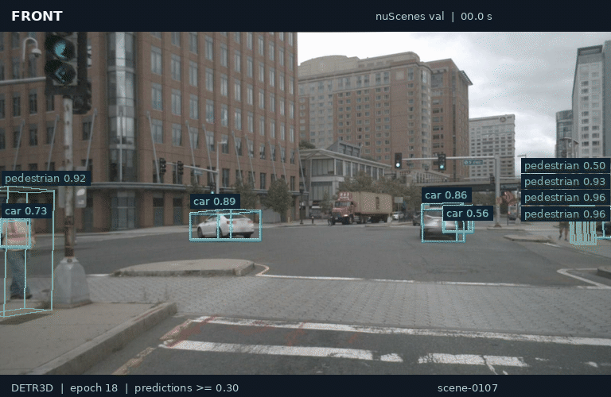
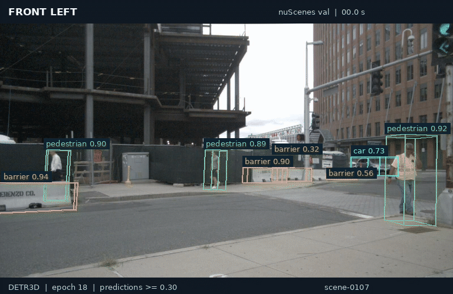
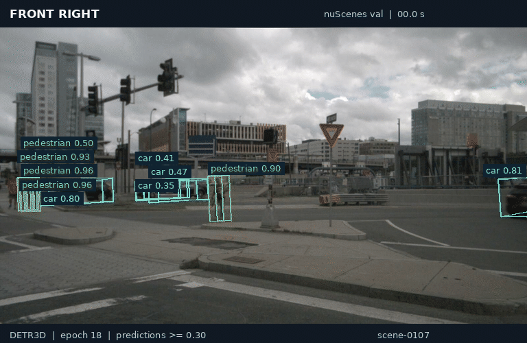
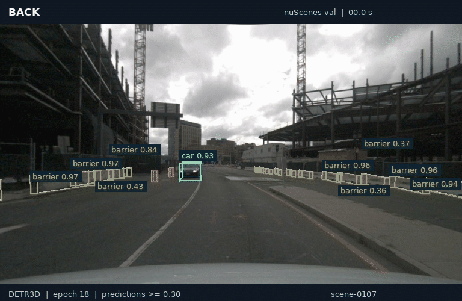

# DETR3D in Pure PyTorch

This repository reproduces DETR3D without MMDetection, MMDetection3D, or MMCV.
The implementation follows the official ResNet-101 + DCNv2 + GridMask model,
training objective, data semantics, initialization, schedule, and nuScenes
evaluation behavior using PyTorch and TorchVision components.

## Reproduction Result

The faithful single-seed run used the official nuScenes train split and a
24-epoch schedule. Both local results below were evaluated on all **6,019
validation samples**. Scores use the 0–100 scale; mAP is mean average precision
and NDS is the nuScenes detection score.

| Model | Checkpoint | mAP | NDS |
|---|---|---:|---:|
| Official DETR3D, ResNet-101 + DCN + GridMask | Upstream baseline | 34.70 | 42.20 |
| Pure PyTorch, same variant | Epoch 24, historical result | **34.58** | **42.15** |
| Pure PyTorch, same variant | **Epoch 18, retained weights** | **33.98** | **41.37** |

The epoch-24 weights are no longer retained. The available
`best_eval_checkpoint.pt` is epoch 18, selected by mean center distance on a
fixed 512-sample diagnostic subset. Its full-validation scores are reported
separately above. The GIFs below use these retained epoch-18 weights.

The historical final result is within 0.12 mAP and 0.05 NDS points of the
[official base model](https://github.com/WangYueFt/detr3d#evaluation-using-pretrained-models).
This is a single-seed reproduction; it does not establish statistical
equivalence across repeated runs. See the [training report](docs/analysis/c6-full-training.md)
for the historical evaluation record.

## Camera Predictions

Four synchronized views from nuScenes validation **scene-0107**: 20 consecutive
keyframes, approximately 10 seconds at native playback speed. Colored wireframes
show predicted 3D boxes projected onto each camera; labels show class and
confidence. The display threshold is **0.30**. Inference uses all six cameras.

| Front | Front left |
|:---:|:---:|
|  |  |
| **Front right** | **Rear** |
|  |  |

These are qualitative examples from one scene. Checkpoint checksum, sample
tokens, and rendering settings are recorded in [media metadata](docs/media/predictions.json).
Camera imagery: nuScenes, © Motional; resized and annotated with predictions.
The GIFs are shared under [CC BY-NC-SA 4.0](https://creativecommons.org/licenses/by-nc-sa/4.0/)
and the [nuScenes dataset terms](https://www.nuscenes.org/terms-of-use).

## Training Details

| Setting | Value |
|---|---|
| Data | nuScenes v1.0-trainval; 28,130 train / 6,019 validation samples |
| Model | ResNet-101 + modulated DCNv2 + FPN; 6 decoder layers; 900 queries |
| Inputs | 6 cameras, 900 × 1600 each; official BGR preprocessing and padding |
| Initialization / augmentation | FCOS3D backbone/FPN; GridMask and photometric distortion |
| Schedule | 24 epochs; retained checkpoint at epoch 18; seed 0 |
| Run duration | About 3 days 6 hours, including validation and recovery |
| Batch | 4 samples × 2 accumulation steps = effective batch 8 |
| Optimizer | AdamW; LR `2e-4`, backbone LR `2e-5`, weight decay `0.01` |
| LR schedule | Cosine; 500 warmup updates from 1/3 LR; minimum LR ratio `0.001` |
| Precision / clipping | FP32 (AMP disabled); gradient norm capped at 35 |
| Targets / loss | Official GT filtering; encoded 10D boxes; Hungarian matching, focal + L1 losses |
| Sampling | Standard train split; class-balanced group sampling (CBGS) disabled |

## Implementation

OpenMMLab behavior is reproduced with local modules:

- TorchVision ResNet-101 and `DeformConv2d` replace the MMDetection backbone
  and MMCV modulated DCNv2 operator.
- Local FPN, GridMask, transformer, cross-attention, detection head, losses,
  box coder, and training loop replace MMDetection/MMCV modules.
- The local nuScenes dataset and CBGS implementation replace MMDetection3D data
  wrappers and pipelines.
- SciPy provides exact Hungarian assignment.
- The official nuScenes devkit is called directly for mAP, NDS, and TP errors.

The official FCOS3D checkpoint supplies backbone/FPN initialization. Its weights
are translated into this repository's parameter names at load time; OpenMMLab
is not required at runtime.

## Repository Layout

```text
detr3d/
├── train.py                         # training entry point
├── eval.py                          # diagnostics and official evaluation
├── COMMAND_GUIDE.md                 # canonical commands
├── notebooks/
│   └── detr3d_e2e_walkthrough.ipynb
├── detr3d/
│   ├── data/                        # nuScenes data and CBGS
│   ├── engine/                      # trainer, diagnostics, evaluator
│   ├── models/                      # DETR3D architecture and checkpoint loader
│   ├── experiments/                 # reproducible search protocols
│   └── scripts/                     # regression and benchmark tools
├── docs/analysis/                   # implementation and result rationale
└── tests/
```

Datasets, checkpoints, MLflow stores, logs, and training outputs are excluded
from version control. The four README GIFs and their metadata live in `docs/media/`.

## Setup

Create an environment with Python 3.11 and install the package dependencies:

```bash
pip install -r requirements.txt
```

Prepare nuScenes `v1.0-trainval` using its standard directory layout. Dataset
files are not distributed with this repository.

The faithful training path also requires the official FCOS3D initialization
checkpoint from the [upstream pretrained-weight collection](https://drive.google.com/drive/folders/1h5bDg7Oh9hKvkFL-dRhu5-ahrEp2lRNN?usp=sharing),
linked in the [official training instructions](https://github.com/WangYueFt/detr3d#train).
Place it at `checkpoints/fcos3d.pth` or change the path in the training command.
The checkpoint used for the reproduced run had SHA-256:

```text
b6cd0590879adc21d2a54bebde44811391f006434a2ffcdc6b41480b2e95be48
```

## Training And Evaluation

The [command guide](COMMAND_GUIDE.md) is the canonical reference. The exact
C6 launch and recovery procedure is in the [training report](docs/analysis/c6-full-training.md).
After preparing nuScenes and the FCOS3D initialization checkpoint, this command
uses the same model, data, and optimization settings:

```bash
python train.py \
  --dataroot /path/to/nuscenes --version v1.0-trainval \
  --dataset-split train --val-split val \
  --epochs 24 --batch-size 4 --accumulation-steps 2 \
  --num-workers 4 --pin-memory --persistent-workers \
  --image-height 900 --image-width 1600 --num-queries 900 \
  --official-gt-semantics --official-image-backbone \
  --official-image-preprocessing --disable-pretrained-backbone \
  --init-fcos3d-checkpoint checkpoints/fcos3d.pth \
  --grid-mask --photometric-distortion \
  --lr 2e-4 --backbone-lr-mult 0.1 --weight-decay 0.01 \
  --scheduler cosine --scheduler-total-epochs 24 \
  --warmup-steps 500 --warmup-ratio 0.3333333333333333 \
  --min-lr-ratio 0.001 --grad-clip-norm 35 \
  --max-val-samples 512 --num-eval-samples 512 --eval-every 1 \
  --num-eval-artifact-samples 4 --eval-max-boxes 100 \
  --save-every 1 --seed 0 --output-dir outputs/c6_full_v1
```

### Retained Weights

The retained local checkpoint is
`outputs/c6_full_v1/best_eval_checkpoint.pt` (**614 MiB**, epoch 18).
It contains model weights, optimizer/scheduler state, class names, training
arguments, and history. It is excluded from Git; no public download is currently
provided. Training from scratch also requires re-downloading the FCOS3D
initialization weights described above.

SHA-256:

```text
a71c87c4e132a460b9f416af4a9bfd9c0a7e70cdf1a22e95f8a4d20ebcd20792
```

Run full official validation with the retained checkpoint:

```bash
python eval.py \
  --checkpoint outputs/c6_full_v1/best_eval_checkpoint.pt \
  --dataroot /path/to/nuscenes --version v1.0-trainval --dataset-split val \
  --nuscenes-results-out outputs/validation/results_nusc.json \
  --run-nuscenes-eval --nuscenes-eval-set val \
  --nuscenes-eval-output-dir outputs/validation/metrics
```

The evaluator restores the model and preprocessing settings from the checkpoint.
For labeled six-camera still images (predictions plus ground truth):

```bash
python eval.py \
  --checkpoint outputs/c6_full_v1/best_eval_checkpoint.pt \
  --dataroot /path/to/nuscenes --version v1.0-trainval --dataset-split val \
  --num-eval-samples 4 --score-threshold 0.30 --max-boxes 100 \
  --save-overlay-dir outputs/camera_overlays \
  --summary-out outputs/camera_overlays/summary.json
```

## Educational Walkthrough

`notebooks/detr3d_e2e_walkthrough.ipynb` is a standalone, literate definition of
the full DETR3D architecture. It implements GridMask, the image backbone and
FPN, multiview feature sampling, cross-attention, the iterative transformer and
head, and the box codec in notebook cells instead of importing the production
model. Production imports are limited to surrounding dataset, matching/loss,
diagnostic, and official-evaluation demonstrations.

The default mode runs deterministic reduced synthetic probes, including a real
optimization step, without nuScenes data or a checkpoint. Real-data,
strict-checkpoint-parity, and official-evaluation paths are separately guarded
opt-ins. See `COMMAND_GUIDE.md` for the exact smoke command and path settings.
The documented pytest commands execute its cells without writing a temporary
notebook or changing the committed file, which has no stored outputs or
execution counts.

## Verification

Run the unit suite with:

```bash
PYTEST_DISABLE_PLUGIN_AUTOLOAD=1 python -m pytest -q
```

For behavioral changes, also run the canonical one-sample regression from
`COMMAND_GUIDE.md` and compare against the recorded baseline before launching
larger experiments.
